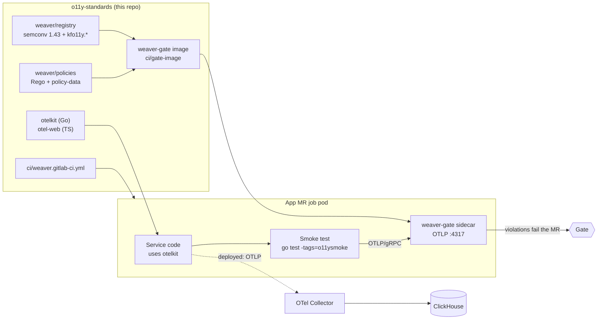
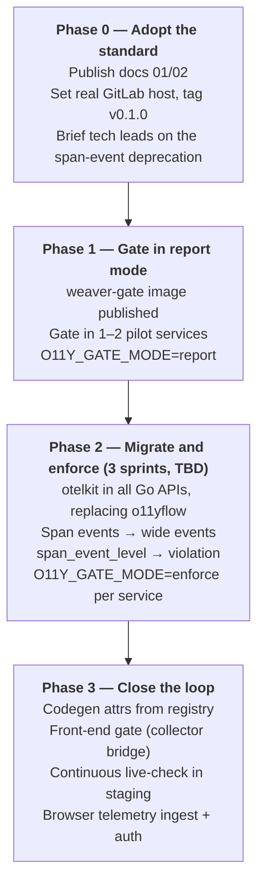

# o11y-standards

The SRE org's telemetry standard, the Weaver gate that enforces it, and the
libraries that make following it the easy path.

| Path | What it is |
|---|---|
| `docs/` | The standard and developer guides (start with 00, then 01 and 02); `zensical.toml` renders them as a site |
| `weaver/registry/` | Org telemetry registry: `kfo11y.*` attributes and wide-event schemas, on top of OTel semconv v1.43.0 |
| `weaver/policies/`, `weaver/policy-data/`, `weaver/weaver.toml` | Rego rules, their tunables, and shared live-check config |
| `ci/gate-image/` | The weaver-gate image: Weaver + registry + policies + semconv, baked in |
| `ci/weaver.gitlab-ci.yml` | Include-able GitLab job that gates app pipelines |
| `.github/workflows/docs.yml` | Builds the docs site on PRs, deploys it to GitHub Pages from `main` |
| `.github/workflows/ci.yml` | This repo's CI on GitHub (`.gitlab-ci.yml` is the GitLab equivalent, kept for later) |
| `otelkit/` | Go library: provider setup, HTTP middleware, wide events, jobs |
| `otel-web/` | TypeScript package for React front ends |
| `dev/` | Local OTel Collector + ClickHouse stack, and `rollups.sql` (metric rollups over wide events) |
| `scripts/` | `gate-local.sh` (run the gate locally), `gate-verdict.sh` (enforce-mode check of a report), `check-pins.sh`, `update-upstream-policy.sh`, `o11y-smoke.sh` |

> **Placeholders:** `gitlab.example.com` (Go module path, registry
> `schema_url`) and `registry.gitlab.example.com` (gate image) stand in for
> the real GitLab host. Replace them before the first tag. See
> [docs/00-team-notes.md](docs/00-team-notes.md).

## How the pieces fit



## Try it locally

```sh
# Telemetry stack: collector on :4317 (gRPC) / :4318 (HTTP), ClickHouse on :8123 / :9000
docker compose -f dev/docker-compose.yaml up -d

# Example service, exporting to the collector
cd otelkit
OTEL_EXPORTER_OTLP_ENDPOINT=http://127.0.0.1:4317 OTEL_EXPORTER_OTLP_PROTOCOL=grpc \
DEPLOYMENT_ENVIRONMENT=development SERVICE_VERSION=0.0.0-dev \
  go run ./example &
curl -H 'X-User-Id: usr_1' localhost:8080/v1/policies/p-1

# Look at the wide events
docker compose -f dev/docker-compose.yaml exec clickhouse \
  clickhouse-client --user otel --password otel -d otel \
  -q "SELECT EventName, LogAttributes FROM otel_logs ORDER BY Timestamp DESC LIMIT 5"
```

Queries for RED metrics, SLIs and tenant impact are in
[docs/02](docs/02-logging-standard-wide-events.md#querying-wide-events). To
run the gate locally instead, see [docs/03](docs/03-weaver-gate.md#running-it-locally).

## Roadmap



## Decisions made here

| Decision | Why |
|---|---|
| `otelkit` **replaces o11yflow** | otelkit is small (setup, middleware, wide events) and built around the current goals. o11yflow can be retired once services move over. |
| Weaver ships as the **weaver-gate image**, run as a CI service | Weaver, semconv and policies are baked in and versioned with this repo, so jobs download nothing. On the Kubernetes executor the gate is a sidecar in the job pod. |
| Semconv pinned to **v1.43.0**, not the latest v1.44.0 | v1.43.0 is the newest version both the Go SDK and opentelemetry-js ship constants for. Move when both catch up. |
| Registry definitions in Weaver **v1** format | The v2 format isn't stable yet, and live-check has an open bug that ignores dependency attributes for v2 registries (weaver#1814). The manifest uses the `definition_manifest/2.0` file format, which Weaver 0.27 requires. |
| Wide events as **OTel log-based events** | Upstream direction (OTEP 4430). Go Logs API/SDK went stable in otel-go v1.47.0 (2026-10-02). |
| Durations in **seconds** (`kfo11y.duration`) | Matches OTel duration conventions; avoids a second unit in queries. |
| Gate starts in **report** mode | Teams see findings before anything blocks. Enforcement is per service, by flipping one variable. |

## Status of this code

Verified on Weaver 0.27.0, OTel Go v1.47.0 / contrib v0.72.0, and the
current OTel JS packages:

- The registry passes `registry check --future`; the policy self-test passes
  with networking disabled inside the gate image.
- The example service passes the gate end to end, in both go-test and
  process mode, through the same script the CI template runs. Deliberately
  broken telemetry produces the expected findings.
- otelkit unit tests pass with `-race`; otel-web type-checks.
- Spans, metrics and wide events round-trip through the `dev/` collector into
  ClickHouse, and the queries in docs/02 run against that schema.

GitHub Actions (`.github/workflows/ci.yml`) runs the same checks as
`.gitlab-ci.yml`: gate image build and self-test, the gate against the example
service in enforce mode, otelkit tests and the otel-web typecheck. A `v*` tag
publishes the tested image to GHCR.

Not yet run on real GitLab: the pipelines have been linted as YAML, and the
job scripts were run locally, but not on GitLab runners. See
[docs/00-team-notes.md](docs/00-team-notes.md).
