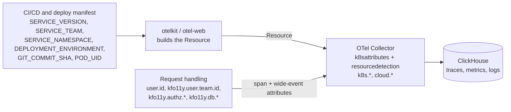

# 01 — Telemetry Standard: Metadata

**Applies to:** every service the SRE org supports (Go APIs, React UIs).
**Baseline:** OpenTelemetry semantic conventions **v1.43.0** plus the org
registry in `weaver/registry/`.
**Enforced by:** the Weaver gate ([03](03-weaver-gate.md)).

This page is the single view of our metadata: where each attribute comes
from, the [full list on wide events](#wide-events-the-full-list), what
[belongs only to tracing](#tracing-only), and what to
[keep for metric aggregation](#metric-aggregation). The registry is the
source of truth for names and types; this page adds where each one goes and
how it's used.

## Principles

1. **Use OpenTelemetry names first.** If semconv defines an attribute, use it.
   Org attributes exist only for concepts semconv doesn't cover, and they all
   live under `kfo11y.` so they can never collide with a future OTel name.
2. **Names are low-cardinality; values can be high-cardinality.** Span names,
   event names, and `http.route` are templates. User IDs, policy IDs, and
   tenants go in attribute values.
3. **Metadata comes from automation, not from hand-typed code.** Identity comes
   from the deployment and CI; Kubernetes and cloud metadata come from the
   collector. The only metadata your code adds is what only the request knows:
   who called, what was decided, what it cost.
4. **One unit of work → one span tree and one wide event.** See
   [02](02-logging-standard-wide-events.md).
5. **The wide event is the record; the span is the shape.** Anything a metric,
   SLI, or audit depends on goes on the wide event, because spans are sampled.

## Three places metadata lives

| | Resource | Wide event | Span |
|---|---|---|---|
| **Describes** | Who and where: the process | One unit of work: a request, job, or UI interaction | One operation's timing and position in a trace |
| **Sent** | Once per batch, attached to every span, metric, and log | Once, when the work finishes | Once per operation; a request has several |
| **Sampled** | With its signal | Never: every event is kept | Yes, with the trace |
| **In ClickHouse** | `ResourceAttributes` on every table | `otel_logs` rows; attributes in `LogAttributes` | `otel_traces` rows; attributes in `SpanAttributes` |
| **Feeds metrics** | Its bounded attributes are rollup dimensions | Yes: [rollups](#metric-aggregation) are built from it | No |

Don't copy resource attributes onto spans or events. They're already
attached to everything the process sends.

## Where metadata comes from



## Resource attributes

Set once per process and sent with every span, metric, and log record.

| Attribute | Required | Source | Example | Gate check |
|---|---|---|---|---|
| `service.name` | Yes | `OTEL_SERVICE_NAME` / otelkit config | `policy-api` | CI (Rego) |
| `service.namespace` | Yes | `SERVICE_NAMESPACE` | `policy` | CI (Rego) |
| `service.version` | Yes | `SERVICE_VERSION` from CI | `1.4.32` | CI (Rego) |
| `service.instance.id` | Yes | `POD_UID` (downward API); otelkit falls back to a UUID | `7d3c…` | CI (Rego) |
| `deployment.environment.name` | Yes | `DEPLOYMENT_ENVIRONMENT` | `production` | CI (Rego, allowlist) |
| `kfo11y.service.team` | Yes | `SERVICE_TEAM` / pod label | `policy-team` | CI (Rego) |
| `vcs.ref.head.revision` | Yes | Go build info; `GIT_COMMIT_SHA` fallback | `8f7a2b3c` | CI (Rego) |
| `service.criticality` | Recommended | Deploy manifest | `critical` | Registry |
| `k8s.cluster.name`, `k8s.namespace.name`, `k8s.deployment.name`, `k8s.pod.name`, `k8s.pod.uid`, `k8s.node.name` | Yes | Collector `k8sattributes` | — | Staging live-check (phase 3) |
| `cloud.provider`, `cloud.region`, `cloud.availability_zone` | Yes | Collector `resourcedetection` | `aws`, `us-east-1` | Staging live-check (phase 3) |

Notes:

- **`service.namespace` is the product area**, not the Kubernetes namespace
  and never environment-specific. Values like `policy-dev` mix the two; split
  them into `service.namespace=policy` and `deployment.environment.name=development`.
- **`deployment.environment.name`** should use the OpenTelemetry well-known
  values `production`, `staging`, `test`, `development` wherever they fit.
  Local values (such as `ci`) are allowed only once they're in
  `weaver/policy-data/kfo11y.yaml`. Set it explicitly; don't derive it from
  `metadata.namespace`.
- `service.criticality` is new in semconv and still alpha, but it's a good fit
  for a critical authn/z service: alert routing and sampling can key off it.
- The SDKs also add `telemetry.sdk.*`, `process.*`, `os.*`, `host.name` and
  `container.id` on their own. Nothing depends on them.

Deployment snippet:

```yaml
env:
  - name: OTEL_SERVICE_NAME
    value: "policy-api"
  - name: SERVICE_NAMESPACE
    value: "policy"
  - name: SERVICE_TEAM
    value: "policy-team"
  - name: SERVICE_VERSION
    value: "1.4.32"            # injected by CI
  - name: DEPLOYMENT_ENVIRONMENT
    value: "production"        # set explicitly per environment
  - name: POD_UID
    valueFrom:
      fieldRef:
        fieldPath: metadata.uid
  - name: OTEL_EXPORTER_OTLP_ENDPOINT
    value: "http://otel-collector.observability:4318"
```

## Wide events: the full list

Every attribute any wide event can carry, across the three events. The
definitions live in `weaver/registry/events.yaml`; the gate checks emitted
events against them.

Columns: **Request** = `kfo11y.request.summary`, **Job** =
`kfo11y.job.summary`, **UI** = `kfo11y.ui.interaction.summary`.

**R** required · **C** conditionally required (see the conditions below) ·
**Rec** recommended · **Opt** opt-in, set by the SDK helpers · — not on this event

| Attribute | Type | Request | Job | UI |
|---|---|---|---|---|
| `http.request.method` | string | R | — | — |
| `http.route` | string | C | — | — |
| `http.response.status_code` | int | C | — | — |
| `kfo11y.job.name` | string | — | R | — |
| `kfo11y.ui.action` | string | — | — | R |
| `kfo11y.ui.route` | string | — | — | R |
| `kfo11y.duration` | double (s) | R | R | R |
| `kfo11y.outcome` | enum | R | R | R |
| `error.type` | string | C | C | C |
| `user.id` | string | C | — | C |
| `kfo11y.user.team.id` | string | C | — | C |
| `kfo11y.user.tier` | string | Rec | — | — |
| `session.id` | string | — | — | Rec |
| `kfo11y.authz.decision` | enum | C | — | — |
| `kfo11y.authz.policy.id` | string | Rec | — | — |
| `kfo11y.db.query.count` | int | Rec | Rec | — |
| `kfo11y.db.query.duration` | double (s) | Rec | Rec | — |
| `kfo11y.cache.hit` | boolean | Rec | — | — |
| `kfo11y.cache.retry.count` | int | Rec | — | — |
| `kfo11y.feature_flags.enabled` | string[] | Rec | — | — |
| `kfo11y.ui.api_call.count` | int | — | — | R |
| `kfo11y.ui.api_call.error.count` | int | — | — | R |
| `kfo11y.wide_event.truncated` | boolean | Opt | Opt | Opt |
| `kfo11y.wide_event.dropped_attributes.count` | int | Opt | Opt | — |

Conditions and notes:

- **`http.request.method`**: `_OTHER` for non-standard methods.
- **`http.route`**: if a route matched. A template, never the raw path.
- **`http.response.status_code`**: if a response was sent.
- **`kfo11y.job.name`, `kfo11y.ui.action`, `kfo11y.ui.route`**: low-cardinality
  names and templates, e.g. `policy-cache-refresh`, `save_policy`,
  `/policies/:policyId`.
- **`kfo11y.duration`**: end to end, in seconds. Spans have their own start
  and end.
- **`kfo11y.outcome`**: see [values](#enum-values).
- **`error.type`**: request and job events, if the outcome is `upstream_error`
  or `server_error`; UI events, if the outcome isn't `success` or `denied`. A
  class, never a message.
- **`user.id`, `kfo11y.user.team.id`**: once the caller is authenticated (UI:
  signed in). `kfo11y.user.team.id` is the tenant; `kfo11y.user.tier` is its
  service tier.
- **`session.id`**: otel-web sets it once per page load.
- **`kfo11y.authz.decision`**: if an authorization decision was evaluated;
  `kfo11y.authz.policy.id` names the policy that made it.
- **`kfo11y.db.*`, `kfo11y.cache.*`**: roll-ups for the unit of work.
  Per-query detail stays on CLIENT spans.
- **`kfo11y.ui.api_call.error.count`**: API calls that failed with a network
  error or status ≥ 400.
- **`kfo11y.wide_event.*`**: set by the SDK helpers when values were shortened
  or attributes dropped to fit the size limits ([02](02-logging-standard-wide-events.md#guardrails)).

**Also on the span**, so trace search can filter on them: the HTTP
attributes (`http.request.method`, `http.route`, `http.response.status_code`)
and `kfo11y.ui.action` / `kfo11y.ui.route` are native span attributes too.
otelkit also copies `kfo11y.outcome`, `error.type`, `user.id`,
`kfo11y.user.team.id` and `kfo11y.authz.decision` onto the Go span. otel-web
doesn't; a failed UI interaction puts `error.type` in the span status
instead. Job spans are named by `kfo11y.job.name`. Everything else is on the
event only, and the event is the source of truth.

**Every wide event also carries** the log record's own fields: `EventName`,
`Timestamp`, `SeverityText` / `SeverityNumber` (derived from the outcome),
a short `Body` for humans (don't parse it), and `TraceId` / `SpanId` from the
active span. `trace_id` and `span_id` are never attributes. The
[resource](#resource-attributes) arrives with each batch, so every event can
be filtered by service, version, environment, and team without repeating
them.

**PII:** `user.id` must be an opaque internal identifier, never an email
address or employee number. If the only identifier available is PII, hash it
in the collector with the `transform` processor before export.

### Enum values

| Attribute | Value | Meaning |
|---|---|---|
| `kfo11y.outcome` | `success` | Completed as intended |
| | `denied` | Completed, and the answer was "no" (e.g. an authorization deny). Not an error |
| | `client_error` | The caller's request couldn't be served (4xx) |
| | `upstream_error` | A dependency failed (database, cache, another API) |
| | `server_error` | This service failed |
| | `ui_error` | Front end only: browser code failed without an API error |
| `kfo11y.authz.decision` | `allow` / `deny` / `indeterminate` | `indeterminate`: no decision could be reached (missing policy, evaluation error) |

## Tracing only

Spans model topology and timing. They're sampled, so nothing that metrics,
SLIs, or audits depend on may live only on a span. These belong on spans and
nowhere else:

| What | Attributes and fields | Why it stays on the span |
|---|---|---|
| Trace structure | `TraceId`, `SpanId`, `ParentSpanId`, `SpanKind`, `SpanName`, start and end time, status, links | Only meaningful inside a trace. Wide events carry `TraceId` / `SpanId` as a pointer back, nothing more |
| Connection detail on SERVER spans (set by otelhttp) | `url.path`, `url.scheme`, `server.address`, `server.port`, `client.address`, `network.peer.address`, `network.peer.port`, `network.protocol.version`, `user_agent.original`, `http.request.body.size`, `http.response.body.size` | Per connection, often client-controlled or high-cardinality. Useful for debugging one request; the wide event keeps `http.route`, not `url.path` |
| Per-call detail on CLIENT spans | Database: `db.system.name`, `db.namespace`, `db.operation.name`, `db.collection.name`, `db.query.summary`, `db.response.status_code`, `server.address`, `server.port`. Outbound HTTP: `http.request.method`, `http.response.status_code`, `server.address`, `url.full`. Messaging: `messaging.system`, `messaging.operation.name`, `messaging.destination.name` | One span per call. The wide event keeps the roll-up instead (`kfo11y.db.query.*`, `kfo11y.cache.*`) |
| Job and UI span names | Job spans are named by `kfo11y.job.name`; UI spans are `ui.{action}` | The span name is the low-cardinality key; the event carries the attribute |

Semconv 1.43 has no `valkey` value for `db.system.name`; Redis-protocol
client instrumentation reports Valkey calls as `redis`. `url.full` must never
contain credentials; strip them in the client instrumentation or redact them
in the collector.

### Span requirements

| Rule | Why | Gate check |
|---|---|---|
| HTTP server span name is `{method} {route}`, e.g. `GET /v1/policies/{id}` | Bounded cardinality for span-derived RED metrics and GROUP BYs | `kfo11y_high_cardinality_span_name` |
| HTTP server spans carry `http.route` (except 404/405) | RED metrics per route | `kfo11y_missing_http_route` |
| `http.request.method`, `http.response.status_code`, `url.scheme`, `server.address` per HTTP semconv (stable) | Consistent queries | Built-in |
| A span with no parent is never `CLIENT` | A CLIENT root means context was lost | ClickHouse hygiene query ([03](03-weaver-gate.md#what-it-checks)) |
| No orphaned spans: propagate W3C `traceparent` on every hop | One trace per request | Visible in trace views; not gated |
| No new span events (`AddEvent`, `RecordException`) | Span Event API is deprecated upstream | `kfo11y_span_event_deprecated` |

`span.kind` values: SERVER for inbound requests, CLIENT for outbound calls,
INTERNAL for in-process work and jobs, PRODUCER/CONSUMER for messaging.

## Metric aggregation

RED metrics and SLIs are SQL over wide events in ClickHouse. Raw events are
kept for a short window (the exporter's TTL), so anything we want to chart
over months has to be kept in a rollup. That's a materialized view that
groups each minute of events by a few dimensions and keeps only aggregates.
An attribute qualifies as a dimension only if its set of values is bounded:
it doesn't grow with traffic, users, or deploys.

**Dimensions: keep in rollups and group by them**

| Attribute | Level | Notes |
|---|---|---|
| `deployment.environment.name` | Resource | Always filter on it |
| `service.name`, `service.namespace`, `kfo11y.service.team` | Resource | Ownership and alert routing |
| `service.version` | Resource | Bounded by retention; compares deploys |
| `k8s.cluster.name`, `cloud.region` | Resource | Add once the platform runs more than one cluster or region |
| `http.request.method`, `http.route`, `http.response.status_code` | Request event | Route is a template, so it's bounded |
| `kfo11y.outcome`, `error.type` | All events | `error.type` is a class by design |
| `kfo11y.authz.decision` | Request event | Three values |
| `kfo11y.job.name` | Job event | |
| `kfo11y.ui.route`, `kfo11y.ui.action` | UI event | |
| `kfo11y.user.team.id`, `kfo11y.user.tier` | Request event (tenant is on UI events too) | Tenant dimensions, kept in **their own rollup** (without route) so tenants × routes × status never multiplies out. The rollup covers requests; query UI tenant impact on raw events |

**Measures: aggregate them, never group by them**

| Attribute | Kept as |
|---|---|
| `kfo11y.duration` | Count, sum, and a quantile sketch (p50 / p90 / p99) |
| `kfo11y.db.query.count`, `kfo11y.db.query.duration` | Sums: database share of request time |
| `kfo11y.cache.hit` | Lookups and hits, for a hit ratio |
| `kfo11y.cache.retry.count` | Sum |
| `kfo11y.ui.api_call.count`, `kfo11y.ui.api_call.error.count` | Sums |
| `kfo11y.wide_event.truncated` | Count: a data-quality signal |

**Drill-down only: never a dimension**

These stay in the raw wide events and spans, and age out with them:
`user.id`, `session.id`, `kfo11y.authz.policy.id`,
`kfo11y.feature_flags.enabled` (an array; `arrayJoin` it on raw events when
needed), `service.instance.id`, `k8s.pod.name`, `k8s.pod.uid`,
`k8s.node.name`, `host.name`, `container.id`, `vcs.ref.head.revision` (group by
`service.version` instead), `kfo11y.wide_event.dropped_attributes.count`
(the `truncated` count already flags the problem), `TraceId` / `SpanId`, and everything in
[Tracing only](#tracing-only). If the number of policies turns out to be
small, `kfo11y.authz.policy.id` can be promoted to a dimension later.

### The rollups

`dev/rollups.sql` defines four, all `AggregatingMergeTree` tables fed by
materialized views over `otel_logs`:

| Table | Grain | Dimensions |
|---|---|---|
| `kfo11y_request_rollup_1m` | 1 minute | environment, service, namespace, team, version, method, route, status, outcome, error type, authz decision |
| `kfo11y_tenant_rollup_5m` | 5 minutes | environment, service, tenant, tier, outcome |
| `kfo11y_job_rollup_1m` | 1 minute | environment, service, version, job, outcome, error type |
| `kfo11y_ui_rollup_1m` | 1 minute | environment, service, version, UI route, action, outcome, error type |

Load them into the `dev/` stack with
`clickhouse-client --multiquery < dev/rollups.sql` (full command in the
file). Materialized views only see new rows; the file says how to backfill.
The 13-month TTL is a placeholder for the platform's retention policy.

RED per route over 30 days, from the rollup:

```sql
SELECT
    service,
    route,
    sum(requests) AS total,
    sumIf(requests, outcome IN ('server_error', 'upstream_error')) AS errors,
    round(errors / total, 4) AS error_rate,
    sum(duration_sum) / total AS mean_s,
    quantilesTDigestMerge(0.5, 0.9, 0.99)(duration_q) AS p50_p90_p99_s,
    sum(cache_hits) / nullIf(sum(cache_lookups), 0) AS cache_hit_ratio
FROM kfo11y_request_rollup_1m
WHERE environment = 'production'
  AND t > now() - INTERVAL 30 DAY
GROUP BY service, route
ORDER BY total DESC;
```

Did the last deploy regress?

```sql
SELECT
    version,
    sum(requests) AS total,
    sumIf(requests, outcome IN ('server_error', 'upstream_error')) / total AS error_rate,
    quantilesTDigestMerge(0.5, 0.99)(duration_q) AS p50_p99_s
FROM kfo11y_request_rollup_1m
WHERE service = 'policy-api'
  AND t > now() - INTERVAL 7 DAY
GROUP BY version
ORDER BY version;
```

For the last few days at full detail (any attribute, any slice), query the
raw events directly ([02](02-logging-standard-wide-events.md#querying-wide-events)).

### SDK metrics

otelkit's HTTP middleware (otelhttp) also emits `http.server.request.duration`
and the body-size histograms, with `http.request.method`, `http.route`,
`http.response.status_code`, `url.scheme` and `network.protocol.*`. otelkit
drops `server.address` and `server.port` from them with a metric view: semconv
makes them opt-in for metrics, because they come from the Host header and a
client can use them to inflate cardinality. They stay on the SERVER span.
Treat the wide-event rollups as the source for RED, and the SDK histograms as
a cross-check.

## Changes from the previous metadata guidance

| Previous | Now | Reason |
|---|---|---|
| `deployment.environment` | `deployment.environment.name` | Renamed in semconv; stable since 1.41 |
| `http.method`, `http.status_code` | `http.request.method`, `http.response.status_code` | Old names deprecated; the gate fails them |
| `cloud.az` | `cloud.availability_zone` | Semconv name |
| `service.team` | `kfo11y.service.team` | `service.*` belongs to OpenTelemetry |
| `service.build.git_hash` | `vcs.ref.head.revision` | Semconv VCS attribute (release candidate since 1.43) |
| `user.team.id`, `user.tier` | `kfo11y.user.team.id`, `kfo11y.user.tier` | Org concepts go under the org prefix |
| `db.query_count`, `db.duration_ms`, `cache.hit`, `cache.retry_count` | `kfo11y.db.query.count`, `kfo11y.db.query.duration`, `kfo11y.cache.hit`, `kfo11y.cache.retry.count` | `db.*` belongs to OpenTelemetry; seconds, not ms |
| `main: true` | Log record `EventName` = `kfo11y.request.summary` | First-class field; Weaver validates events by name |
| `duration_ms`, `outcome` | `kfo11y.duration` (s), `kfo11y.outcome` | Org prefix; OTel duration unit |
| `trace_id`, `span_id` attributes | Log record trace context | Native correlation fields |
| Logs as span events | Log-based events ([02](02-logging-standard-wide-events.md)) | Span Event API deprecated |
| `semconv/v1.24.0` in Go examples | otelkit; registry pinned to v1.43.0 | 19 versions behind |

## Proposing a new attribute

1. Search the OpenTelemetry attribute registry. If it exists there, use it.
2. Otherwise open an MR on this repo adding it to `weaver/registry/attributes.yaml`
   under `kfo11y.`, with a brief, type, examples, and the event(s) that reference it.
3. Say where it goes on this page: which events, whether it's copied onto the
   span, and whether it's a metric dimension, a measure, or drill-down only.
4. `registry:check` must pass. SRE reviews for naming and cardinality.
5. Tag a release; services pick it up by bumping `O11Y_STANDARDS_REF`.
