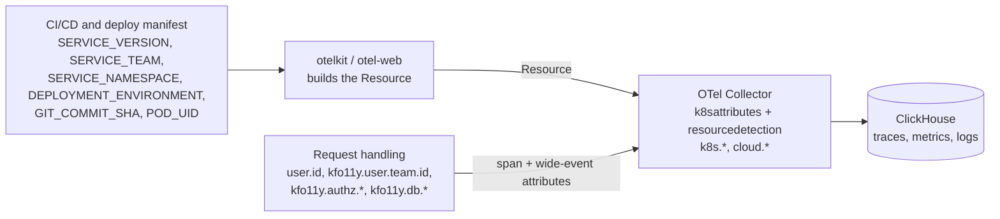

# 01 — Telemetry Standard: Metadata Expectations

**Applies to:** every service the SRE org supports (Go APIs, React UIs).
**Baseline:** OpenTelemetry semantic conventions **v1.43.0** plus the org
registry in `weaver/registry/`.
**Enforced by:** the Weaver gate ([03](03-weaver-gate.md)).

## Principles

1. **Use OpenTelemetry names first.** If semconv defines an attribute, use it.
   Org attributes exist only for concepts semconv doesn't cover, and they all
   live under `kfo11y.` so they can never collide with a future OTel name.
2. **Names are low-cardinality; values can be high-cardinality.** Span names,
   event names, and `http.route` are templates. User IDs, policy IDs, and
   tenants go in attribute values.
3. **Metadata comes from automation, not from hand-typed code.** Identity comes
   from the deployment and CI; Kubernetes and cloud metadata come from the
   collector. The only metadata your code adds is what only the request knows:
   who called, what was decided, what it cost.
4. **One unit of work → one span tree and one wide event.** See
   [02](02-logging-standard-wide-events.md).

## Where metadata comes from



## Resource attributes

Set once per process and sent with every span, metric, and log record. Do
not copy them onto individual events.

| Attribute | Required | Source | Example | Gate check |
|---|---|---|---|---|
| `service.name` | Yes | `OTEL_SERVICE_NAME` / otelkit config | `prs` | CI (Rego) |
| `service.namespace` | Yes | `SERVICE_NAMESPACE` | `policy` | CI (Rego) |
| `service.version` | Yes | `SERVICE_VERSION` from CI | `1.4.32` | CI (Rego) |
| `service.instance.id` | Yes | `POD_UID` (downward API); otelkit falls back to a UUID | `7d3c…` | CI (Rego) |
| `deployment.environment.name` | Yes | `DEPLOYMENT_ENVIRONMENT` | `production` | CI (Rego, allowlist) |
| `kfo11y.service.team` | Yes | `SERVICE_TEAM` / pod label | `halo` | CI (Rego) |
| `vcs.ref.head.revision` | Yes | Go build info; `GIT_COMMIT_SHA` fallback | `8f7a2b3c` | CI (Rego) |
| `service.criticality` | Recommended | Deploy manifest | `critical` | Registry |
| `k8s.cluster.name`, `k8s.namespace.name`, `k8s.deployment.name`, `k8s.pod.name`, `k8s.pod.uid`, `k8s.node.name` | Yes | Collector `k8sattributes` | — | Staging live-check (phase 3) |
| `cloud.provider`, `cloud.region`, `cloud.availability_zone` | Yes | Collector `resourcedetection` | `aws`, `us-gov-west-1` | Staging live-check (phase 3) |

Notes:

- **`service.namespace` is the product area**, not the Kubernetes namespace
  and never environment-specific. Values like `policy-dev` mix the two; split
  them into `service.namespace=policy` and `deployment.environment.name=development`.
- **`deployment.environment.name`** should use the OpenTelemetry well-known
  values `production`, `staging`, `test`, `development` wherever they fit.
  Local values (such as `ci`) are allowed only once they're in
  `weaver/policy-data/kfo11y.yaml`. Set it explicitly; don't derive it from
  `metadata.namespace`.
- `service.criticality` is new in semconv and still alpha, but it's a good fit
  for a critical authn/z service: alert routing and sampling can key off it.

Deployment snippet:

```yaml
env:
  - name: OTEL_SERVICE_NAME
    value: "prs"
  - name: SERVICE_NAMESPACE
    value: "policy"
  - name: SERVICE_TEAM
    value: "halo"
  - name: SERVICE_VERSION
    value: "1.4.32"            # injected by CI
  - name: DEPLOYMENT_ENVIRONMENT
    value: "production"        # set explicitly per environment
  - name: POD_UID
    valueFrom:
      fieldRef:
        fieldPath: metadata.uid
  - name: OTEL_EXPORTER_OTLP_ENDPOINT
    value: "http://otel-collector.observability:4318"
```

## Span requirements

| Rule | Why | Gate check |
|---|---|---|
| HTTP server span name is `{method} {route}`, e.g. `GET /v1/policies/{id}` | Bounded cardinality for span-derived RED metrics and GROUP BYs | `kfo11y_high_cardinality_span_name` |
| HTTP server spans carry `http.route` (except 404/405) | RED metrics per route | `kfo11y_missing_http_route` |
| `http.request.method`, `http.response.status_code`, `url.scheme`, `server.address` per HTTP semconv (stable) | Consistent queries | Built-in |
| A span with no parent is never `CLIENT` | A CLIENT root means context was lost | ClickHouse hygiene query ([03](03-weaver-gate.md#what-it-checks)) |
| No orphaned spans: propagate W3C `traceparent` on every hop | One trace per request | Visible in trace views; not gated |
| No new span events (`AddEvent`, `RecordException`) | Span Event API is deprecated upstream | `kfo11y_span_event_deprecated` |

`span.kind` values: SERVER for inbound requests, CLIENT for outbound calls,
INTERNAL for in-process work and jobs, PRODUCER/CONSUMER for messaging.

## Wide-event schema

Full definitions live in `weaver/registry/events.yaml`. Summary for
`kfo11y.request.summary`:

| Attribute | Type | Requirement | Notes |
|---|---|---|---|
| `http.request.method` | string | Required | `_OTHER` for non-standard methods |
| `http.route` | string | Required if matched | Template, never the raw path |
| `http.response.status_code` | int | Required if sent | |
| `kfo11y.duration` | double (s) | Required | Replaces `duration_ms` |
| `kfo11y.outcome` | enum | Required | `success`, `denied`, `client_error`, `upstream_error`, `server_error` |
| `error.type` | string | Required on errors | Low-cardinality class, never the message |
| `user.id` | string | Required once authenticated | See PII note |
| `kfo11y.user.team.id` | string | Required once authenticated | Tenant; replaces `user.team.id` |
| `kfo11y.user.tier` | string | Recommended | Replaces `user.tier` |
| `kfo11y.authz.decision` | enum | Required if evaluated | `allow`, `deny`, `indeterminate` |
| `kfo11y.authz.policy.id` | string | Recommended | |
| `kfo11y.db.query.count` / `kfo11y.db.query.duration` | int / double (s) | Recommended | Roll-ups; per-query detail stays on CLIENT spans |
| `kfo11y.cache.hit`, `kfo11y.cache.retry.count` | bool / int | Recommended | |
| `kfo11y.feature_flags.enabled` | string[] | Recommended | |

`trace_id` and `span_id` are not attributes: they're the log record's own
trace-context fields, populated automatically from the active span.

**PII:** `user.id` must be an opaque internal identifier, never an email
address or employee number. If the only identifier available is PII, hash it in the
collector with the `transform` processor before export.

## Changes from the previous metadata guidance

| Previous | Now | Reason |
|---|---|---|
| `deployment.environment` | `deployment.environment.name` | Renamed in semconv; stable since 1.41 |
| `http.method`, `http.status_code` | `http.request.method`, `http.response.status_code` | Old names deprecated; the gate fails them |
| `cloud.az` | `cloud.availability_zone` | Semconv name |
| `service.team` | `kfo11y.service.team` | `service.*` belongs to OpenTelemetry |
| `service.build.git_hash` | `vcs.ref.head.revision` | Semconv VCS attribute (release candidate since 1.43) |
| `user.team.id`, `user.tier` | `kfo11y.user.team.id`, `kfo11y.user.tier` | Org concepts go under the org prefix |
| `db.query_count`, `db.duration_ms`, `cache.hit`, `cache.retry_count` | `kfo11y.db.query.count`, `kfo11y.db.query.duration`, `kfo11y.cache.hit`, `kfo11y.cache.retry.count` | `db.*` belongs to OpenTelemetry; seconds, not ms |
| `main: true` | Log record `EventName` = `kfo11y.request.summary` | First-class field; Weaver validates events by name |
| `duration_ms`, `outcome` | `kfo11y.duration` (s), `kfo11y.outcome` | Org prefix; OTel duration unit |
| `trace_id`, `span_id` attributes | Log record trace context | Native correlation fields |
| Logs as span events | Log-based events ([02](02-logging-standard-wide-events.md)) | Span Event API deprecated |
| `semconv/v1.24.0` in Go examples | otelkit; registry pinned to v1.43.0 | 19 versions behind |

## Proposing a new attribute

1. Search the OpenTelemetry attribute registry. If it exists there, use it.
2. Otherwise open an MR on this repo adding it to `weaver/registry/attributes.yaml`
   under `kfo11y.`, with a brief, type, examples, and the event(s) that reference it.
3. `registry:check` must pass. SRE reviews for naming and cardinality.
4. Tag a release; services pick it up by bumping `O11Y_STANDARDS_REF`.
