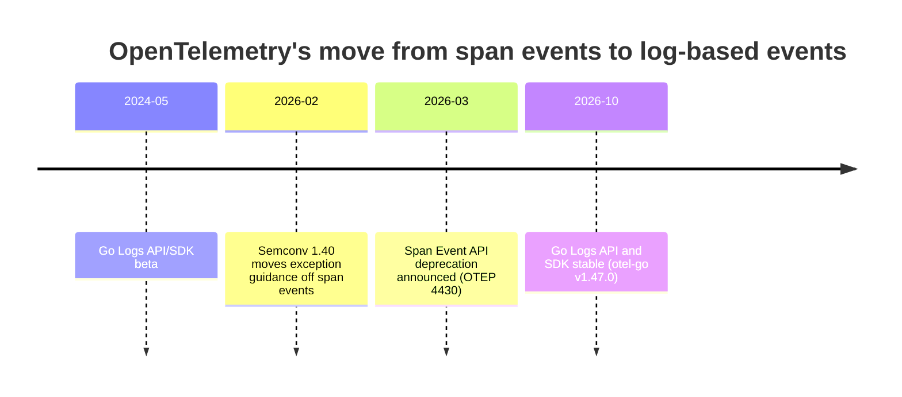
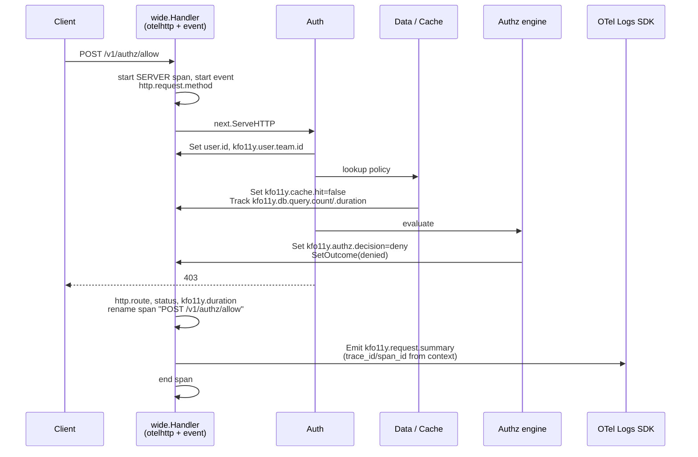

# 02 — Logging Standard: Wide Events

**Status:** Proposed · **Owner:** SRE · **Supersedes:** "Logging Standard – Wide Events" (draft) and the practice of recording log messages as span events

## Summary

Every unit of work — an HTTP request, a background job, a user interaction in
the UI — emits **one** structured, context-rich record when it finishes: a
*wide event*. It is an OpenTelemetry **log-based event** (a log record with an
event name), correlated with the trace through context. It replaces both
scattered free-text log lines and log messages attached to spans as span
events.

This isn't a house preference. It is where OpenTelemetry itself has gone, and
as of this month every piece we need is stable.

## Where we are

When OpenTelemetry was first integrated into our services, log messages were
moved onto span events. Given the state of the ecosystem then, that was a
defensible choice: span events were the stable, trace-correlated place to put
detail, and the Go Logs API was still in beta. The result today is that our
services emit almost no logs, and the operational detail we do have lives
inside spans.

## What changed upstream



1. **The Span Event API is deprecated.** In March 2026 OpenTelemetry announced
   it is deprecating `Span.AddEvent` and `Span.RecordException`. The guidance
   for new code is to emit events as logs correlated with the current span.
   The project's model is now "events are logs with names." Existing span-event
   data stays valid; it's the *API* that is being retired.
   ([blog](https://opentelemetry.io/blog/2026/deprecating-span-events/),
   [OTEP 4430](https://github.com/open-telemetry/opentelemetry-specification/blob/fd43145dde7e5192ebc59a20992d98a3e6af5553/oteps/4430-span-event-api-deprecation-plan.md))
2. **Semantic conventions followed.** Semconv v1.40 deprecated recording
   exceptions as span events and added an opt-in switch for emitting them as
   logs. The same release deprecated `error.message`.
3. **The Go blocker is gone.** OpenTelemetry Go v1.47.0 (2026-10-02) is the
   first stable release of the Go Logs API and SDK. The reason not to use OTel
   logs from Go no longer applies.

Staying on span events means building more code on an API OpenTelemetry has
said it is retiring. Moving now means one migration, done on our schedule,
instead of a forced one later.

## Why wide events, specifically

Span events and free-text logs have practical costs for us beyond the
deprecation:

| Problem | Span events | Free-text logs | Wide event |
|---|---|---|---|
| Survives trace sampling | No — dropped with the span | Yes | Yes — log records aren't subject to trace sampling |
| Visible before the span ends | No — exported with the span | Yes | Yes |
| Queryable as rows in ClickHouse | Awkward (nested arrays) | Needs parsing | Native columns |
| Consistent field names | Per developer | Per developer | Schema in the registry, enforced by Weaver |
| Answers "who, what, how long, what failed" in one row | No | No — spread over 15+ lines | Yes |

With ClickHouse as our single telemetry store, wide events are also the
cheapest source of RED metrics and SLIs: request rate, error rate, and latency
percentiles per route, tenant, or version are one `GROUP BY` over
`kfo11y.request.summary` rows, with no pre-aggregation and no cardinality
budget to manage.

The sampling row matters most for cost. With wide events carrying the
operational record, we can sample traces aggressively and still keep 100% of
the per-request records for RED metrics, tenant isolation, and incident
forensics.

## The standard

1. **One wide event per unit of work.** Inbound HTTP requests emit
   `kfo11y.request.summary`; jobs and message handlers emit `kfo11y.job.summary`;
   UI interactions emit `kfo11y.ui.interaction.summary`. The otelkit and
   otel-web helpers do this; you enrich, they emit.
2. **Enrich as you go.** Auth adds the caller, data access adds counts and
   time, the authz engine adds the decision, error handling adds `error.type`.
3. **Use registry attributes only.** Every attribute must be defined in
   OpenTelemetry semconv or `weaver/registry/`. The gate fails unknown ones.
4. **No new span events.** Don't call `AddEvent` or `RecordException` in new
   code. Detail goes on the wide event; a genuinely separate occurrence is a
   named event (rule 6).
5. **No free-text logs for operations.** `log.Printf` and `fmt.Println` aren't
   telemetry. Local debugging output is fine; it isn't shipped or relied on.
6. **Point-in-time events get a name and a schema.** Something that happens
   outside a request — a cache reload, a policy bundle activation, a
   certificate rotation — is a named log-based event defined in the registry,
   not a sentence.
7. **Errors are classified, not narrated.** Put a low-cardinality class in
   `error.type` (implement `ErrorType()` on your error types). Messages and
   stack traces don't go on the wide event.

## How it works: context accumulation



## What one looks like

As the collector receives it (simplified OTLP):

```json
{
  "resource": {
    "service.name": "prs", "service.namespace": "policy", "service.version": "3.4.1",
    "kfo11y.service.team": "halo", "deployment.environment.name": "production",
    "vcs.ref.head.revision": "8f7a2b3c", "k8s.pod.name": "prs-7f8g9-2x5",
    "cloud.availability_zone": "us-gov-west-1a"
  },
  "event_name": "kfo11y.request.summary",
  "trace_id": "4bf92f3577b34da6a3ce929d0e0e4736",
  "span_id": "00f067aa0ba902b7",
  "severity_text": "INFO",
  "body": "POST /v1/authz/allow 403 denied",
  "attributes": {
    "http.request.method": "POST",
    "http.route": "/v1/authz/allow",
    "http.response.status_code": 403,
    "kfo11y.duration": 0.0124,
    "kfo11y.outcome": "denied",
    "user.id": "usr_99",
    "kfo11y.user.team.id": "partner-a",
    "kfo11y.authz.decision": "deny",
    "kfo11y.authz.policy.id": "pol-1842",
    "kfo11y.cache.hit": false,
    "kfo11y.db.query.count": 1,
    "kfo11y.db.query.duration": 0.0031
  }
}
```

Severity follows the outcome: `success` and `denied` are INFO,
`client_error` is WARN, `upstream_error` and `server_error` are ERROR. A 403
is `client_error` by default; handlers that return a deliberate authorization
deny call `SetOutcome(denied)` so a correct "no" isn't counted as an error.

## Guardrails

| Limit | Value | Enforced by |
|---|---|---|
| Target size | 8 KiB | Gate: `kfo11y_wide_event_over_target` (improvement) |
| Hard limit | 16 KiB | otelkit drops non-essential attributes; gate: `kfo11y_wide_event_too_large` (violation) |
| String value | 1 KiB | otelkit / otel-web truncate and set `kfo11y.wide_event.truncated` |
| Array value | 32 elements | otelkit truncates |
| Payloads | Never | Request/response bodies, stack traces, and tokens are prohibited. Store a reference (object ID) instead. |
| Credentials | Never | Gate: `kfo11y_sensitive_attribute` (violation); collector redaction as backstop |

## Querying wide events

All queries run against the ClickHouse exporter's default schema
(`otel_logs`, `otel_traces`); wide-event attributes are in the
`LogAttributes` map. They were checked against the `dev/` stack.

**RED per route**

```sql
SELECT
    ServiceName AS service,
    LogAttributes['http.route'] AS route,
    count() AS requests,
    countIf(LogAttributes['kfo11y.outcome'] IN ('server_error', 'upstream_error')) AS errors,
    round(errors / requests, 4) AS error_rate,
    quantile(0.5)(toFloat64OrZero(LogAttributes['kfo11y.duration'])) AS p50_s,
    quantile(0.99)(toFloat64OrZero(LogAttributes['kfo11y.duration'])) AS p99_s
FROM otel_logs
WHERE EventName = 'kfo11y.request.summary'
  AND Timestamp > now() - INTERVAL 1 HOUR
GROUP BY service, route
ORDER BY requests DESC;
```

**Availability and latency SLIs** (5-minute buckets). `denied` and
`client_error` count as good: the service answered correctly.

```sql
SELECT
    ServiceName AS service,
    toStartOfFiveMinutes(Timestamp) AS t,
    count() AS total,
    countIf(LogAttributes['kfo11y.outcome'] NOT IN ('server_error', 'upstream_error')) AS good,
    good / total AS availability,
    countIf(toFloat64OrZero(LogAttributes['kfo11y.duration']) <= 0.3) / total AS latency_sli
FROM otel_logs
WHERE EventName = 'kfo11y.request.summary'
  AND Timestamp > now() - INTERVAL 1 DAY
GROUP BY service, t
ORDER BY t;
```

**Which tenants are hurting**

```sql
SELECT
    LogAttributes['kfo11y.user.team.id'] AS tenant,
    LogAttributes['kfo11y.outcome'] AS outcome,
    count() AS n
FROM otel_logs
WHERE EventName = 'kfo11y.request.summary'
  AND Timestamp > now() - INTERVAL 1 HOUR
GROUP BY tenant, outcome
ORDER BY n DESC;
```

**From a span to its wide event** (the record is on the server span itself)

```sql
SELECT t.SpanName, t.Duration / 1e9 AS span_s, l.LogAttributes
FROM otel_traces AS t
INNER JOIN otel_logs AS l ON l.TraceId = t.TraceId AND l.SpanId = t.SpanId
WHERE l.EventName = 'kfo11y.request.summary'
  AND t.TraceId = '<trace id>';
```

## Migrating off span events

**1. Inventory.** Against the default ClickHouse exporter schema:

```sql
SELECT ServiceName, arrayJoin(Events.Name) AS event, count() AS n
FROM otel_traces
WHERE Timestamp > now() - INTERVAL 7 DAY
GROUP BY ServiceName, event
ORDER BY n DESC;
```

**2. Map each event to its new home.**

| Today's span event | Becomes |
|---|---|
| Step-by-step progress ("validated token", "cache miss", "query done") | Attributes on the wide event (`kfo11y.cache.hit`, `kfo11y.db.query.count`, …) |
| Error / exception messages | `error.type` + `kfo11y.outcome` on the wide event |
| A distinct occurrence worth its own row (cache reload, bundle activated) | Named log-based event in the registry |
| Debug chatter | Delete |

**3. Turn on the gate.** In report mode, `kfo11y_span_event_deprecated` lists
every remaining span event per service as an *improvement*. Once a service's
count reaches zero, it moves to enforce mode. **Target: three sprints after
adoption** (the exact date is still TBD; see [00](00-team-notes.md)), when
`span_event_level` in `weaver/policy-data/kfo11y.yaml` flips to `violation` for
everyone and services log through wide events only.

**4. Trace views keep working.** Log-based events carry the trace and span
IDs, so a trace view backed by ClickHouse (e.g. Grafana's ClickHouse data
source) can show them next to the span by joining on `TraceId`. OpenTelemetry
also plans SDK options to render log-based events back onto spans for tools
that need it.

## Collector side

Wide events ride the normal logs pipeline:

```yaml
processors:
  transform/redact:
    log_statements:
      - context: log
        statements:
          # Backstop only — the gate blocks these at the source.
          - delete_matching_keys(attributes, "(?i).*(password|secret|token|authorization|cookie).*")
service:
  pipelines:
    logs:
      receivers: [otlp]
      processors: [memory_limiter, k8sattributes, resourcedetection, transform/redact, batch]
      exporters: [clickhouse]
    # traces and metrics pipelines also export to clickhouse: it is the single
    # telemetry store.
```

## FAQ

**Doesn't this duplicate what's on the span?** Only a handful of keys
(`user.id`, `kfo11y.user.team.id`, `kfo11y.outcome`, `error.type`,
`kfo11y.authz.decision`) are copied onto the span, so trace search works. The
span models topology and timing; the event is the record.

**What about debugging locally?** Set `OTEL_LOGS_EXPORTER=console` and
`OTEL_TRACES_EXPORTER=console`; you'll see the wide event printed per request.

**My handler fails half-way. Do I still get an event?** Yes. The middleware
emits on every exit path, including panics.

**Can I add an attribute that isn't in the registry?** Not in a shipped
service. Propose it ([01, "Proposing a new attribute"](01-telemetry-standard.md#proposing-a-new-attribute));
it's usually a same-day review.
