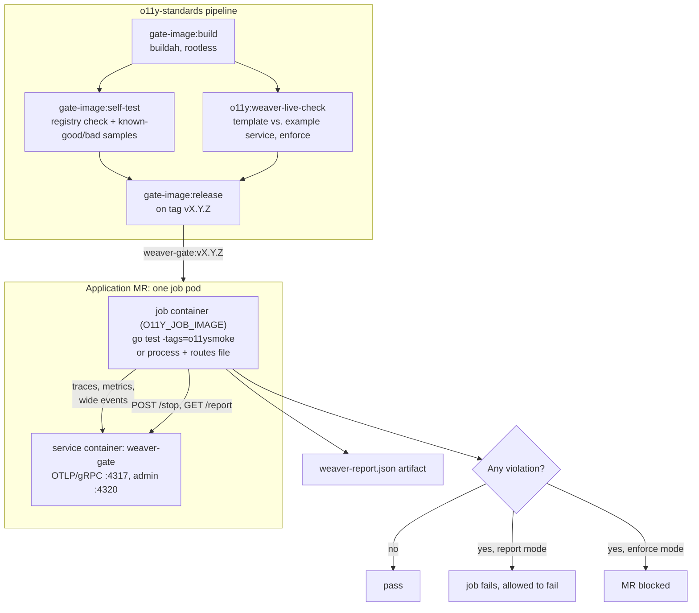

# 03 — The Weaver Gate

The gate checks the telemetry a service **actually emits** against the
registry, on every merge request. It runs
[OpenTelemetry Weaver](https://github.com/open-telemetry/weaver) `registry
live-check` (pinned to v0.27.0) as an OTLP receiver while a smoke test drives
the service.

Weaver ships to CI as the **weaver-gate image**, built by this repo
(`ci/gate-image`): Weaver, the org registry, the policies and their data, and
a checksummed copy of semconv v1.43.0. App pipelines run it as a CI
**service**, which on the Kubernetes executor is a sidecar container in the
job pod. Nothing is downloaded at job time: no Weaver binary, no semconv, no
policies, no clone of this repo.

## What runs where



## What it checks

**Built into Weaver**, against semconv v1.43.0 plus `weaver/registry`:

- Attributes that exist in neither registry (`missing_attribute`)
- Wrong types (`type_mismatch`)
- Deprecated attributes such as `http.method` (`deprecated`, raised to violation here)
- Required attributes missing from the wide events defined in `events.yaml`
- OpenTelemetry naming and namespace advice

`not_stable` findings are filtered out (`weaver/weaver.toml`): the standard
deliberately uses development-stability attributes, and a team can't fix that.

**Org policies** (`weaver/policies/live_check_advice/`):

| Finding id | Level | Meaning | Fix |
|---|---|---|---|
| `kfo11y_missing_resource_attribute` | violation | A required resource attribute is missing | Set it via env/otelkit config ([01](01-telemetry-standard.md#resource-attributes)) |
| `kfo11y_unknown_environment` | violation | `deployment.environment.name` not in the allowlist | Use a well-known value, or add yours to `policy-data/kfo11y.yaml` |
| `kfo11y_high_cardinality_span_name` | violation | ID or UUID in a span name | Use the route template |
| `kfo11y_missing_http_route` | violation | Server span without `http.route` | Use `wide.Handler`; with non-ServeMux routers call `wide.SetRoute` |
| `kfo11y_span_event_deprecated` | improvement → violation | Span event recorded | Move it to the wide event or a named event ([02](02-logging-standard-wide-events.md#migrating-off-span-events)) |
| `kfo11y_wide_event_over_target` | improvement | Wide event above 8 KiB | Trim attributes |
| `kfo11y_wide_event_too_large` | violation | Wide event above 16 KiB | Remove payloads; store references |
| `kfo11y_unnamed_log` | improvement | Log record without an event name | Use the wide event or a registry event |
| `kfo11y_sensitive_attribute` | violation | Attribute name looks like a credential | Remove it at the source |

Levels and limits live in `weaver/policy-data/kfo11y.yaml`, so tuning the gate
is a data change, not a Rego change.

**Checked in ClickHouse instead.** "A span with no parent is never CLIENT"
can't be checked by live-check, because its samples don't carry the parent
span id. Run this against the platform store (or `dev/`) instead:

```sql
-- CLIENT spans with no parent: context was lost before an outbound call.
SELECT ServiceName AS service, SpanName AS span, count() AS n
FROM otel_traces
WHERE SpanKind = 'Client' AND ParentSpanId = ''
  AND Timestamp > now() - INTERVAL 1 DAY
GROUP BY service, span
ORDER BY n DESC;
```

The fix is to wrap the work in `wide.Run`, or make the call inside a handler.

## Adding the gate to a service

1. **Use otelkit** ([04](04-go-guide.md)) so the service exports via the
   standard `OTEL_*` variables.
2. **Add the smoke test.** Copy `otelkit/example/telemetry_smoke_test.go`, keep
   the `o11ysmoke` build tag, and replace the cases with one request per
   route, including at least one error path, and one run of each background
   job. This is often the first integration test a service has; it's worth
   keeping honest.
3. **Include the job:**

   ```yaml
   include:
     - remote: https://raw.githubusercontent.com/benhastings/o11y-standards/v0.1.0/ci/weaver.gitlab-ci.yml

   variables:
     O11Y_SERVICE_NAME: policy-api
     O11Y_SERVICE_NAMESPACE: policy
     O11Y_SERVICE_TEAM: policy-team
     O11Y_JOB_IMAGE: golang:1.26        # your build image; it needs curl
   ```

   Keep the version in the include URL and the tag in `O11Y_GATE_IMAGE` the
   same. The template pulls the gate image from
   `ghcr.io/benhastings/o11y-standards/weaver-gate`; if runners can't reach
   GHCR, mirror it and override `O11Y_GATE_IMAGE`.
4. **Dependencies.** If the smoke test needs MariaDB, Postgres, or Valkey,
   add them as more `services:` on `o11y:weaver-live-check` (keep the
   `weaver` entry). Prefer a smoke test that stubs them, at least at first.

Services that aren't Go, or that can't run in-process, use process mode. The
job starts the service, calls each route in the routes file, then stops it
with SIGTERM so it flushes:

```yaml
variables:
  O11Y_SMOKE_MODE: process
  O11Y_START_CMD: "./bin/server"
  O11Y_SMOKE_ROUTES: o11y-smoke.routes
  O11Y_JOB_IMAGE: $CI_REGISTRY_IMAGE/build:latest   # has the binary and curl
```

```text
# o11y-smoke.routes — METHOD PATH EXPECTED_STATUS [Header:Value ...]
GET  /v1/policies/p-1    200  X-User-Id:usr_1
GET  /v1/policies/p-404  404  X-User-Id:usr_1
GET  /v1/policies/p-1    401
```

## Report mode → enforce mode

| Mode | `O11Y_GATE_MODE` | Effect |
|---|---|---|
| Report (default) | `report` | Job runs and fails visibly on violations, but `allow_failure: true` |
| Enforce | `enforce` | Violations block the merge |

Flip a service to `enforce` once its report is clean. The goal is every
service enforcing by the end of phase 2.

## Running it locally

```sh
# terminal 1 — the same image CI uses
scripts/gate-local.sh start

# terminal 2 — in your service
OTEL_EXPORTER_OTLP_ENDPOINT=http://127.0.0.1:4317 OTEL_EXPORTER_OTLP_PROTOCOL=grpc \
DEPLOYMENT_ENVIRONMENT=development SERVICE_TEAM=policy-team SERVICE_NAMESPACE=policy \
SERVICE_VERSION=0.0.0-dev \
  go test -tags=o11ysmoke -run TestTelemetrySmoke ./...

# terminal 1 — collect the verdict
scripts/gate-local.sh report    # prints counts, writes weaver-report.json
scripts/gate-verdict.sh         # optional: fail like enforce mode would (needs jq)
```

You can also point a running service at it and click through the UI before
running `report`. To try registry or policy changes before they're released,
build the image yourself and use it:

```sh
docker build -f ci/gate-image/Dockerfile -t weaver-gate:dev .
GATE_IMAGE=weaver-gate:dev scripts/gate-local.sh start
docker run --rm --entrypoint gate-self-test -w /tmp weaver-gate:dev /tmp
```

## Maintaining the gate

- **Upgrading Weaver:** bump `WEAVER_IMAGE` (tag and digest) in
  `ci/gate-image/Dockerfile` and `.gitlab-ci.yml`, then run
  `WEAVER_VERSION=x.y.z scripts/update-upstream-policy.sh`. Passing
  `--advice-policies` replaces Weaver's built-in OTel advice policy rather
  than adding to it, so the repo carries a copy (`zz_upstream_otel.rego`).
- **Upgrading semconv:** bump `SEMCONV_VERSION` and `SEMCONV_SHA256` in the
  Dockerfile and the dependency in `weaver/registry/manifest.yaml`, and move
  otelkit/otel-web constants in the same MR.
- **Every live-check run needs `--include-unreferenced`.** Without it, semconv
  attributes our registry doesn't `ref` are reported as `missing_attribute`.
  Weaver 0.27 already warns that this flag is deprecated in favor of explicit
  `imports`; see the follow-ups in [00](00-team-notes.md).

## Known limitations

- **Weaver's OTLP listener is gRPC only.** Browsers export OTLP/HTTP, so the
  front-end gate (phase 3) puts a collector in the CI job to bridge HTTP to
  gRPC, with Playwright driving the UI.
- **Collector-added attributes** (`k8s.*`, `cloud.*`) aren't in the CI path.
  Phase 3 adds a continuous live-check in staging, fed by a collector exporter,
  run with `--inactivity-timeout 0 --output none --emit-otlp-logs` so findings
  land in ClickHouse as logs.
- **Rego input shapes** (verified against a 0.27.0 report): spans are
  `input.sample.span.{name, kind, attributes[].name/value, span_events}` with
  lowercase `kind` and no parent id; resources are
  `input.sample.resource.attributes`; logs are
  `input.sample.log.{event_name, attributes}`; span events are
  `input.sample.span_event.name`; single attributes are
  `input.sample.attribute.name`.
