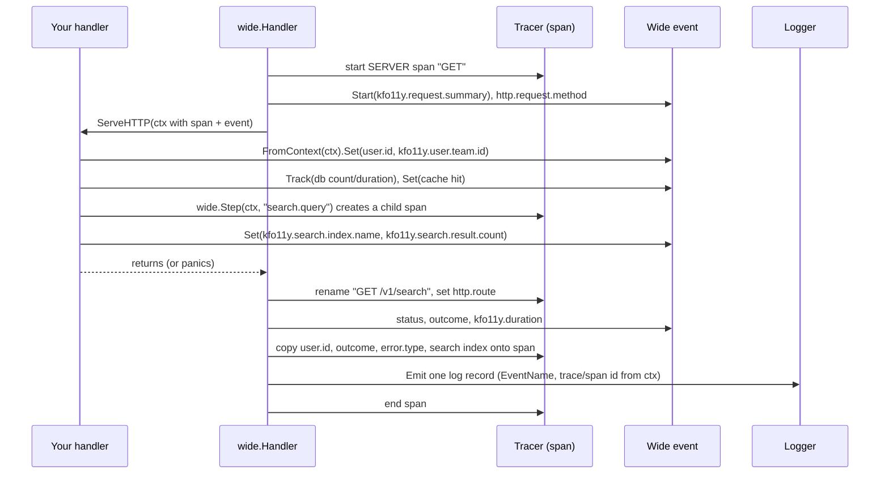

# 04 — Go Instrumentation Guide (otelkit)

`otelkit` gives a Go service the whole standard in about ten lines: provider
setup, HTTP tracing and metrics with correct route naming, and one wide event
per request or job.

## How it fits together

You write three kinds of call; otelkit does the rest with the standard
OpenTelemetry APIs underneath.

| You write | otelkit does | Signal |
|---|---|---|
| `otelkit.Setup` once in `main` | Builds the Resource (service, team, version, environment, commit), sets the global tracer, meter and logger providers, wires exporters from `OTEL_*` | All of them carry the Resource |
| `wide.Handler(mux)` or `wide.Run(ctx, name, fn)` | Starts the SERVER or INTERNAL span, starts the wide event, names the span by route, classifies the outcome, emits the event on every exit path | One span tree + one wide event per unit of work |
| `wide.FromContext(ctx).Set(...)` / `.Track(...)` | Accumulates attributes, counts and durations on the wide event; copies a few onto the span | Wide event (and span) attributes |
| `wide.Step(ctx, name, fn)` (optional) | Starts an INTERNAL child span; on error sets status and `error.type`, no span event | A child span |
| `wide.Log(ctx, name, sev, ...)` (rare) | Emits a named log-based event correlated to the current span | A standalone event |



The Resource is attached by the providers, so nothing in your handler sets
service, team, version, environment, Kubernetes or cloud attributes. Trace
context flows through `ctx`: pass it everywhere and every span, event and
outbound call is correlated without further code.

There is no separate "logger" to set up. The wide event *is* the log record
for the request. `log`/`slog` output stays local (stdout, for humans) and
isn't shipped as telemetry.

## Install

```sh
go get github.com/benhastings/o11y-standards/otelkit@v0.1.0
```

Requires Go 1.26+ and OpenTelemetry Go v1.47.0+ (the first release with a
stable Logs API).

## 1. Set up once, in `main`

```go
func main() {
	ctx, stop := signal.NotifyContext(context.Background(), os.Interrupt, syscall.SIGTERM)
	defer stop()

	shutdown, err := otelkit.Setup(ctx, otelkit.Config{
		ServiceName:      "search-api",
		ServiceNamespace: "search",
		Team:             "search-team",
	})
	if err != nil {
		log.Fatalf("telemetry setup: %v", err)
	}
	defer func() {
		sctx, cancel := context.WithTimeout(context.Background(), 5*time.Second)
		defer cancel()
		_ = shutdown(sctx) // flushes wide events, metrics, traces
	}()

	srv := &http.Server{Addr: ":8080", Handler: wide.Handler(routes())}
	// ... ListenAndServe, wait for ctx.Done(), srv.Shutdown
}
```

Everything in `Config` can be overridden by the environment; see the
deployment snippet in [01](01-telemetry-standard.md#resource-attributes).
Exporter settings come from the standard `OTEL_*` variables, so nothing about
endpoints or protocols is hard-coded.

## 2. Wrap your router

```go
mux := http.NewServeMux()
mux.Handle("GET /v1/documents/{id}", identify(http.HandlerFunc(getDocument)))
mux.Handle("GET /v1/search", identify(http.HandlerFunc(search)))

handler := wide.Handler(mux)
```

`wide.Handler` creates the SERVER span, names it `GET /v1/documents/{id}`,
adds `http.route` to the span and to `http.server.request.duration`, and emits
`kfo11y.request.summary` when the request finishes, including on panic.

Put `wide.Handler` directly around the `ServeMux`. Route detection reads the
pattern ServeMux sets on the request, so a middleware in between that copies
the request (`r.WithContext(...)`) hides it. Wrap individual routes instead,
as `identify` does above, or call `wide.SetRoute`.

Using chi or another router? Report the template after routing:

```go
r.Use(func(next http.Handler) http.Handler {
	return http.HandlerFunc(func(w http.ResponseWriter, req *http.Request) {
		next.ServeHTTP(w, req)
		wide.SetRoute(req.Context(), chi.RouteContext(req.Context()).RoutePattern())
	})
})
```

## 3. Enrich the event where the knowledge lives

Get the event from the context and add to it. All methods are nil-safe.

```go
// Auth: as soon as you know who's calling.
wide.FromContext(ctx).Set(
	attrs.UserID.String(claims.Subject),
	attrs.Kfo11yUserTeamID.String(claims.Team),
)

// Cache.
wide.FromContext(ctx).Set(attrs.Kfo11yCacheHit.Bool(hit))

// Database: count and time every query.
done := wide.FromContext(ctx).Track(attrs.Kfo11yDBQueryCount, attrs.Kfo11yDBQueryDuration)
rows, err := db.QueryContext(ctx, q, args...)
done()

// Search. No results is a correct answer, not an error: the outcome stays success.
wide.FromContext(ctx).Set(
	attrs.Kfo11ySearchIndexName.String("documents"),
	attrs.Kfo11ySearchResultCount.Int(len(hits)),
)
```

Put the `Set`/`Track` calls in your shared packages (auth middleware, DB
wrapper, cache client) once, and every handler gets them for free.

## 4. Classify errors

`error.type` must be low-cardinality. Give your error types a name:

```go
type UpstreamTimeoutError struct{ Dep string }

func (e *UpstreamTimeoutError) Error() string     { return e.Dep + " timed out" }
func (e *UpstreamTimeoutError) ErrorType() string { return "upstream_timeout" }
```

```go
if err != nil {
	ev := wide.FromContext(ctx)
	ev.SetError(err)                          // error.type = "upstream_timeout"
	ev.SetOutcome(attrs.OutcomeUpstreamError) // you decide whose fault it was
	http.Error(w, "unavailable", http.StatusServiceUnavailable)
	return
}
```

Without an `ErrorType()` method, `SetError` records `timeout`, `canceled`, or
`_OTHER`. If you set nothing, a 5xx response gets the status code as
`error.type` and outcome `server_error`.

## 5. Background work

```go
err := wide.Run(ctx, "search-cache-refresh", func(ctx context.Context) error {
	// Outbound calls in here become children of an INTERNAL span,
	// and one kfo11y.job.summary is emitted at the end.
	return refresh(ctx)
})
```

## 6. A step worth its own span

`wide.Handler` and `wide.Run` already create the span for the unit of work.
When one part of it deserves its own bar in the trace (a ranking pass, a
fan-out, a slow computation), wrap it in `wide.Step`:

```go
err := wide.Step(ctx, "search.rank", func(ctx context.Context) error {
	trace.SpanFromContext(ctx).SetAttributes(attrs.Kfo11ySearchIndexName.String("documents"))
	return ranker.Rank(ctx, hits)
})
```

The span is an INTERNAL child of whatever span is in `ctx`; outbound calls
made inside nest under it, and `wide.FromContext(ctx)` still returns the
request's event. On error the span gets status Error and `error.type`. It
does **not** record a span event: `span.RecordError` and `span.AddEvent` are
the deprecated Span Event API. `Step` returns the error unchanged, so setting
`error.type` and the outcome on the wide event is still your call.

The name must be low-cardinality: `search.rank`, never `rank doc-1842`.
Plain `otel.Tracer(...).Start` works too; `Step` just handles the error the
standard way.

## 7. A point-in-time event

Something that happens outside a request or job (a cache reload, a search
index activation, a certificate rotation) is a named log-based event, not a
log line:

```go
wide.Log(ctx, attrs.EventSearchIndexActivation, otellog.SeverityInfo,
	attrs.Kfo11ySearchIndexName.String("documents"),
	attrs.Kfo11ySearchIndexRevision.String(rev),
	attrs.Kfo11yOutcome.String(string(attrs.OutcomeSuccess)))
```

Define the event and its attributes in `weaver/registry/events.yaml` first.
The record is correlated to the span in `ctx` and the wide-event size limits
apply. Detail about a request or job goes on its wide event, never in
`wide.Log`.

## 8. Outbound HTTP

Use an instrumented transport so the downstream service joins the trace:

```go
client := &http.Client{Transport: otelhttp.NewTransport(http.DefaultTransport)}
```

## Do and don't

| Do | Don't |
|---|---|
| Use keys from the `attrs` package | Type attribute names as string literals |
| Put IDs in attribute values | Put IDs in span names or routes |
| Record an empty search as `success` with a result count of 0 | Treat a correct "nothing found" as an error |
| Store a reference to a large payload | Put request bodies, stack traces, or tokens on events |
| Add detail to the wide event | Call `span.AddEvent` / `span.RecordError` (deprecated API) |
| Use `wide.Step` for a span that can fail | Hand-roll spans that record errors as span events |
| Use `wide.Log` with a registry event name | Ship `log`/`slog` lines as telemetry |
| Call `shutdown` on exit | `os.Exit` without flushing |

## Local debugging

```sh
OTEL_TRACES_EXPORTER=console OTEL_LOGS_EXPORTER=console OTEL_METRICS_EXPORTER=none go run ./cmd/server
```

To check your telemetry against the standard before pushing, run the gate
locally ([03](03-weaver-gate.md#running-it-locally)). To see it land in
ClickHouse and try the queries in [02](02-logging-standard-wide-events.md#querying-wide-events),
run the `dev/` stack (README).
