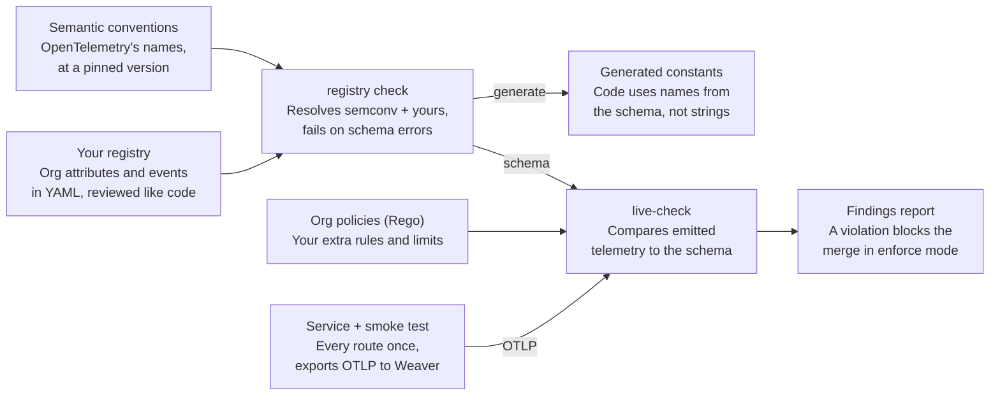

# OpenTelemetry Weaver: A Guide for Service Teams

!!! note "Standalone guide"
    General guidance for any service team, independent of this repository's
    tooling. It uses `myorg.` as a placeholder for your org prefix; this
    repository's own standard uses `kfo11y.` (see [01](../01-telemetry-standard.md)).

## What Weaver is

[OpenTelemetry Weaver](https://github.com/open-telemetry/weaver) turns your telemetry conventions into something a machine can check. You describe your attributes, events, metrics and spans in YAML once; Weaver validates that description, generates code and docs from it, and checks the telemetry your service **actually emits** against it.

For a service team, that means:

- **Typos and drift get caught in CI**, not weeks later when a dashboard is empty.
- **Deprecated OpenTelemetry names get flagged** before they spread (`http.method` instead of `http.request.method`).
- **Constants are generated**, so code uses `attrs.HTTPRoute`, not a hand-typed string.
- **Your schema is documentation.** Anyone can read what an event carries and why.

Weaver is the tool the OpenTelemetry project uses to maintain its own semantic conventions, so the same model covers OpenTelemetry's names and yours.

## Core concepts

Weaver works in two passes: it validates your schema, then validates real telemetry against that schema.



| Concept | What it is |
| --- | --- |
| Semantic conventions | OpenTelemetry's own registry of names (`http.route`, `service.name`), versioned and published as a Weaver registry |
| Your registry | Your org's attributes and events, in YAML, depending on a pinned semconv version |
| Resolved registry | The two merged into one schema, with every reference checked |
| `registry check` | Validates the schema itself; runs when the registry changes |
| `live-check` | Receives OTLP from a running service and reports where it departs from the schema |
| Advice policies | Rego rules that add findings of your own, such as required resource attributes or size limits |
| Finding | One problem in the report, with an id, a level and a message |

## Defining a registry

A registry is a directory of YAML files plus a manifest. Keep it in version control and review changes like code.

```text
registry/
  manifest.yaml     # name, version, semconv dependency
  imports.yaml      # which semconv groups you use
  attributes.yaml   # your own attributes
  events.yaml       # your events and which attributes they carry
```

**The manifest** pins the semantic-conventions version you build on:

```yaml
file_format: definition_manifest/2.0
description: Telemetry registry for search-api and friends.
schema_url: https://example.com/schemas/0.1.0
dependencies:
  - schema_url: https://opentelemetry.io/schemas/1.43.0
    registry_path: https://github.com/open-telemetry/semantic-conventions/archive/refs/tags/v1.43.0.tar.gz[semantic-conventions-1.43.0/model]
```

**Attributes** live in groups. Each has an id, type, stability, a one-line brief and examples:

```yaml
groups:
  - id: registry.myorg.work
    type: attribute_group
    brief: Attributes that summarize one unit of work.
    attributes:
      - id: myorg.duration
        type: double
        stability: development
        brief: End-to-end duration of the unit of work, in seconds.
        examples: [0.142, 1.247]
      - id: myorg.outcome
        type:
          members:
            - id: success
              value: "success"
              brief: Completed as intended.
              stability: development
            - id: server_error
              value: "server_error"
              brief: This service failed.
              stability: development
        stability: development
        brief: How the unit of work ended.
```

**Events** reference attributes, from OpenTelemetry or your own, and set a requirement level for each:

```yaml
groups:
  - id: event.myorg.request.summary
    type: event
    name: myorg.request.summary
    stability: development
    brief: One record per inbound HTTP request.
    attributes:
      - ref: http.request.method
        requirement_level: required
      - ref: http.route
        requirement_level:
          conditionally_required: If the request matched a route.
      - ref: myorg.duration
        requirement_level: required
      - ref: myorg.outcome
        requirement_level: required
```

Tips:

- **Search the OpenTelemetry registry first.** Reference an existing attribute with `ref:` instead of defining your own.
- **Put your attributes under one org prefix**, so they can never collide with a future OpenTelemetry name.
- **Import what you use from semconv** in `imports.yaml` (for example all `registry.*` attribute groups and the HTTP spans and metrics). Weaver only knows semconv definitions you import or reference; without the import, a deprecated name reports as unknown rather than as deprecated.
- **Pin a semconv version your SDKs ship constants for**, and move it forward deliberately.

## Checking the registry and generating code

Run the check on every change to the registry. It resolves your files against semconv and fails on broken references, bad types, duplicate ids and naming problems:

```sh
weaver registry check -r ./registry --future
```

`--future` turns upcoming deprecations into errors now, so you fix them on your schedule. Pin the Weaver version in CI (a container image tag and digest is easiest) so results don't change under you.

Generate constants instead of typing attribute names by hand. Weaver renders Jinja templates over the resolved registry:

```sh
weaver registry generate -r ./registry --templates ./templates go ./internal/attrs
```

If you don't want to maintain templates, keeping a hand-written constants file in sync works too, as long as a CI check compares it against the registry. Either way, the registry is the source of truth; code follows it.

## Live-check: validating real telemetry

A registry check proves the schema is sound. **Live-check** proves your service follows it. Weaver runs as an OTLP receiver; you point the service at it, exercise it, then ask for a report.

```sh
weaver registry live-check -r ./registry \
  --input-source otlp \
  --otlp-grpc-address 0.0.0.0 --otlp-grpc-port 4317 \
  --admin-port 4320 \
  --format json --output http
```

The CI job then does four things:

1. **Start Weaver** as a sidecar or service container next to the test job.
2. **Run a smoke test** with `OTEL_EXPORTER_OTLP_ENDPOINT=http://<weaver>:4317` and `OTEL_EXPORTER_OTLP_PROTOCOL=grpc`. Call every route once, include at least one error path, and run each background job once.
3. **Stop and collect:** `POST :4320/stop`, then `GET :4320/report` for the JSON report, then `POST :4320/shutdown`.
4. **Decide:** fail the job if the report has any `violation`.

Practical advice:

- **Make the smoke test honest.** It's often a service's first integration test. Telemetry you never trigger is telemetry you never check.
- **Make sure the service flushes** before you stop Weaver: shut down the SDK providers, or send SIGTERM and wait.
- **Weaver's OTLP listener is gRPC.** Browser apps export OTLP/HTTP, so put a collector in between for front-end checks.
- **Attributes added by the collector** (Kubernetes, cloud) aren't in the CI path. Check them with a continuous live-check in staging, fed by a collector exporter.
- **Run it locally too.** The same container and the same smoke test should reproduce any CI failure on a laptop.

## Reading findings

Each finding has an id, a level, a message and context (the attribute, span or event it's about). Levels are `violation` (fails the gate), `improvement` (should fix) and `information`.

Findings built into Weaver:

| Finding | Means | Fix |
| --- | --- | --- |
| `missing_attribute` | The name exists in neither semconv nor your registry | Fix the typo, use the semconv name, or propose a registry addition |
| `type_mismatch` | Right name, wrong type (e.g. a status code as a string) | Emit the registered type |
| `deprecated` | A semconv name that has been replaced, such as `http.method` | Switch to the replacement the message names |
| Required attribute missing | An event or span lacks an attribute its definition requires | Set it on every path, including errors |
| `not_stable` | The attribute isn't stable yet | Usually informational; many teams filter it out |

**Custom policies** add your org's rules. They're [Rego](https://www.openpolicyagent.org/docs/latest/policy-language/) files passed with `--advice-policies`, with thresholds in a data file passed with `--advice-data`, so tuning is a data change. Rules worth having:

| Rule | Catches |
| --- | --- |
| Required resource attributes | A service without an owner, version or environment |
| Environment allowlist | `prod`, `Production` and `prd` all meaning the same thing |
| High-cardinality span names | IDs or UUIDs in a span name instead of a route template |
| Sensitive attribute names | Attributes named like `password`, `token` or `authorization` |
| Event size limits | Wide events carrying payloads |
| Unnamed logs | Log records with no event name: free text instead of a defined event |

A policy is a small `deny` rule:

```rego
package live_check_advice

import rego.v1

deny contains {
  "id": "myorg_sensitive_attribute",
  "level": "violation",
  "context": {"attribute_key": input.sample.attribute.name},
  "message": sprintf("Attribute '%s' looks like a secret. Remove it at the source.", [input.sample.attribute.name]),
} if {
  input.sample.attribute
  regex.match(`(?i)(^|[._-])(password|secret|token|authorization|api[_-]?key)($|[._-])`, input.sample.attribute.name)
}
```

Passing your own policies replaces Weaver's built-in advice policy rather than adding to it, so copy the upstream policy into your policy directory to keep its checks.

## Adopting it

1. **Start in report mode.** Run live-check on every merge request, publish the report as a build artifact, and let the job fail visibly without blocking (`allow_failure`).
2. **Burn down the report.** Deprecated names and unknown attributes are usually quick fixes; unnamed-log and size findings take longer.
3. **Switch to enforce mode** once a service's report has no violations. Now regressions block the merge.
4. **Raise the bar gradually.** Promote an `improvement` to a `violation` by changing the policy data, with a date announced in advance.

### FAQ

**Weaver says my attribute is missing, but it's in semconv.** Your registry probably doesn't import that semconv group. Add it to `imports.yaml`.

**Can I emit an attribute that isn't in the registry?** Not in a shipped service. Propose it: name, type, unit, brief, examples, and where it's used. Most additions are a quick review.

**Do I need Weaver installed locally?** No. Run the same container image CI uses, point your smoke test at it, and fetch the report.

**Does live-check slow the pipeline?** Barely. Weaver is a single binary; the smoke test is the cost, and it's a test you want anyway.

**What can't it check?** Anything that needs the whole trace, such as orphaned spans or a CLIENT span with no parent. Check those with a query over your telemetry store.
